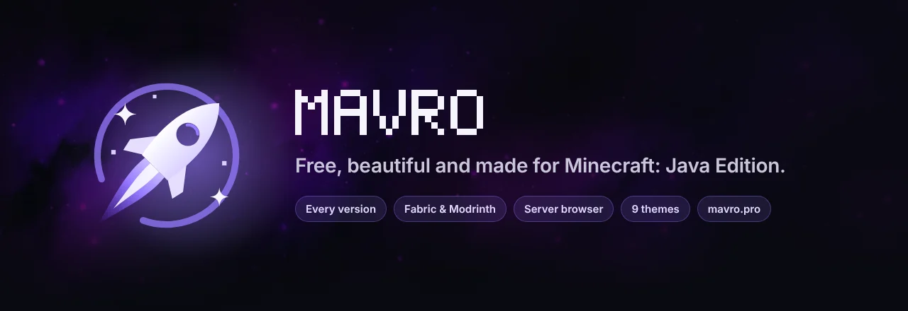
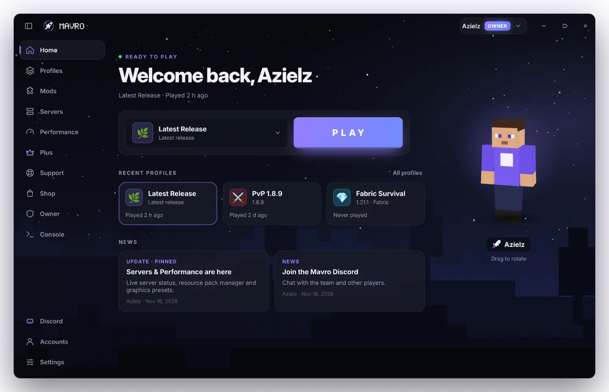
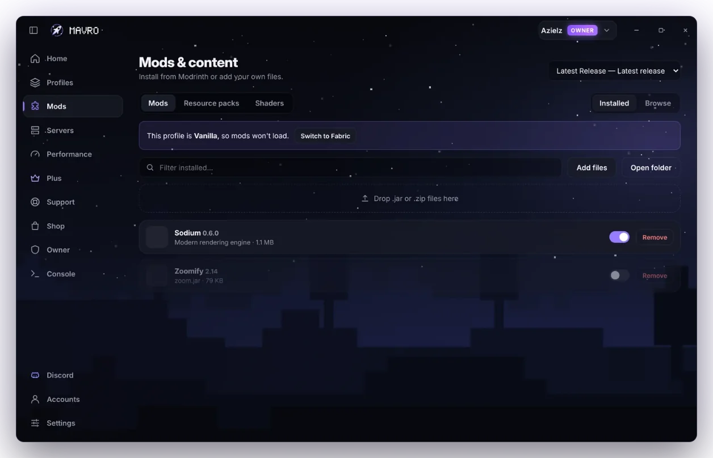
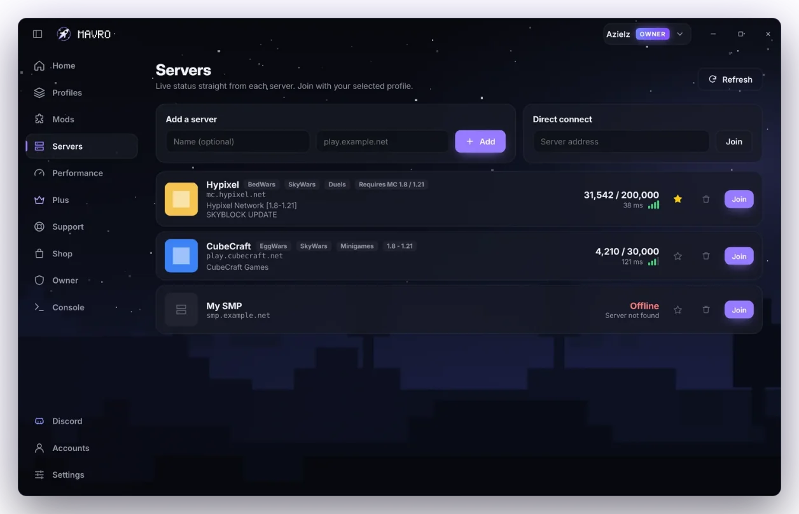
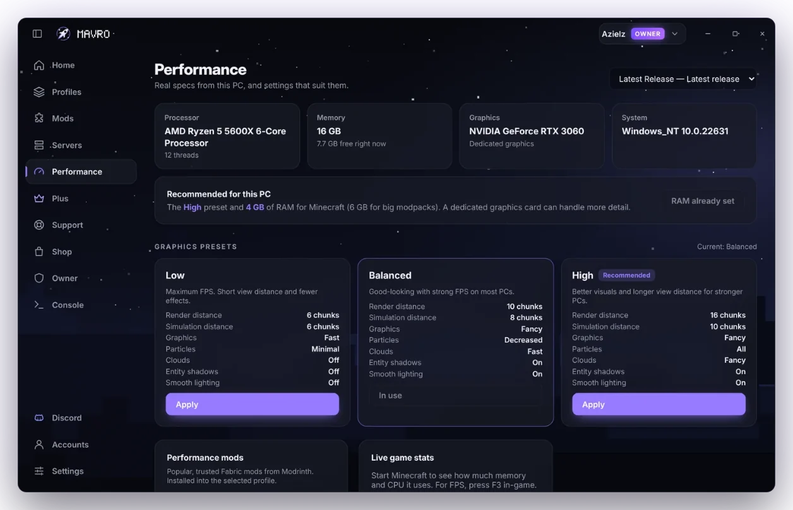
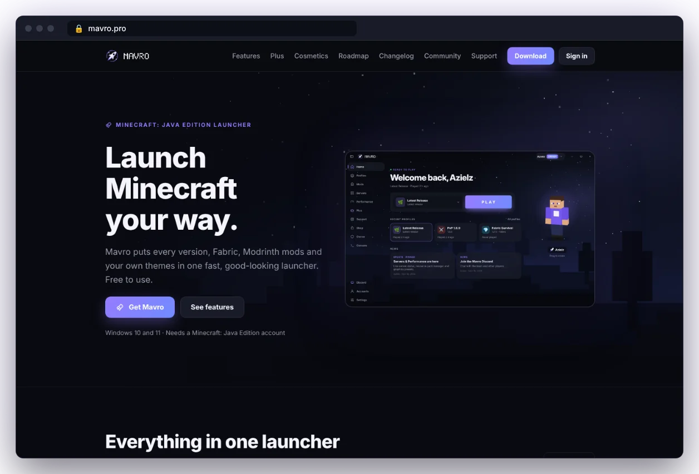
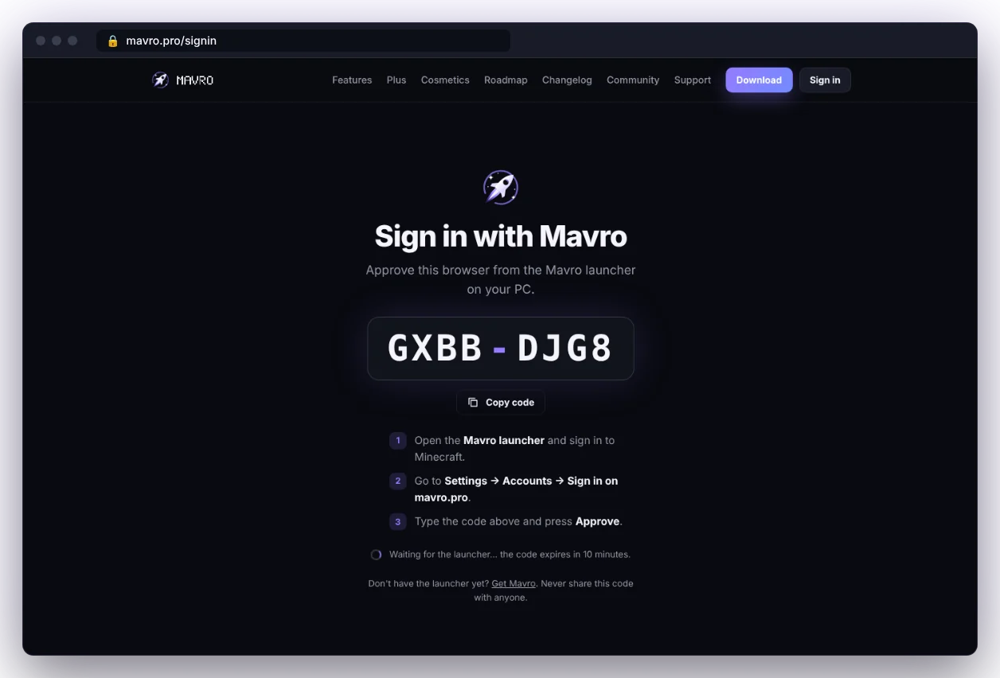
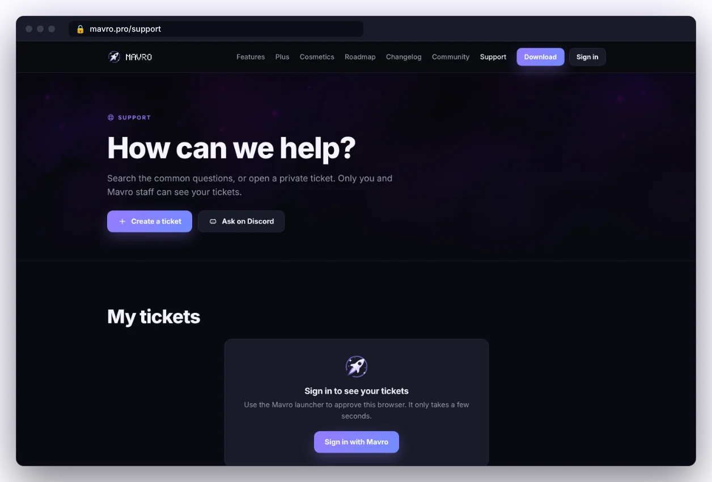
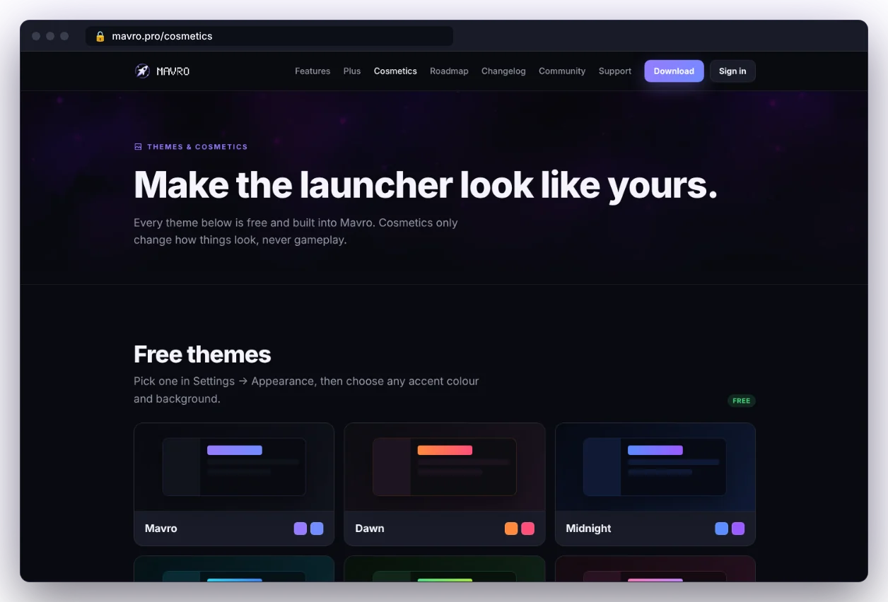
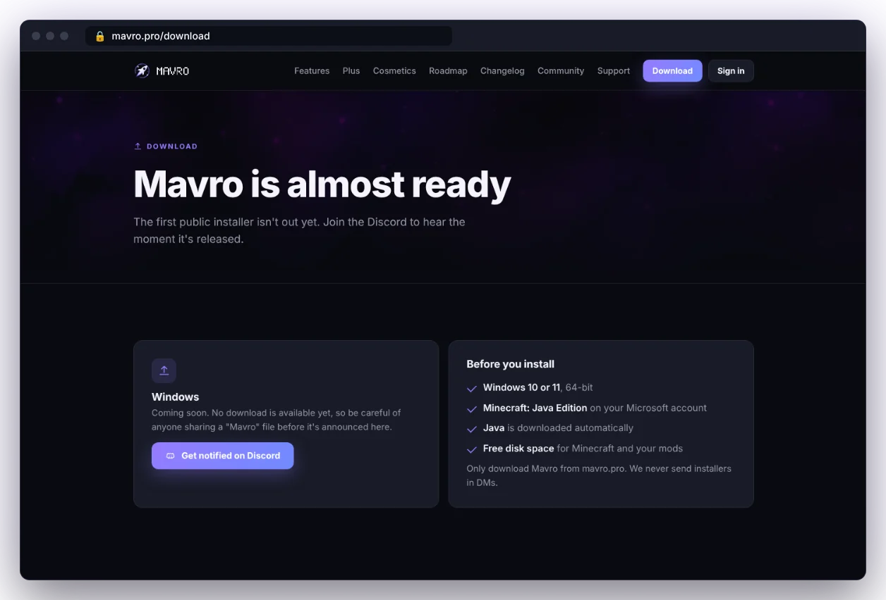

  

  
  
  

  
  
  
  

  <b>Mavro</b> puts every Minecraft version, Fabric, Modrinth mods and your own themes in one fast, good-looking launcher. 
  It comes with its own website, <a href="https://mavro.pro"><b>mavro.pro</b></a>, where you can manage your account, get help and follow what's coming next.

  <a href="#-get-mavro">Get Mavro</a> ·
  <a href="#-the-launcher">The launcher</a> ·
  <a href="#-mavropro">mavro.pro</a> ·
  <a href="#-mavro-plus">MAVRO PLUS</a> ·
  <a href="#-discord">Discord</a> ·
  <a href="#-faq">FAQ</a>

  

---

## 🚀 Get Mavro

1. Go to **[mavro.pro/download](https://mavro.pro/download)**, or grab `Mavro-Setup.exe` from the **[latest release](../../releases/latest)**.
2. Run `Mavro-Setup.exe`. Mavro installs with Start menu and desktop shortcuts.
3. Sign in with your Microsoft account and press **Play**. Mavro downloads Minecraft, the right Java version and your mods for you.

That's it. You don't need to install Java, Node or anything else.

> [!NOTE]
> Windows may say **"Windows protected your PC"** because Mavro is new. Click **More info → Run anyway**. Only download Mavro from **mavro.pro** or the [Releases](../../releases) page on this repository.

**You'll need:** Windows 10 or 11 (64-bit) and a Minecraft: Java Edition account.

---

## 🧭 The launcher

<table>
<tr>
<td width="50%" valign="top">

### Every version, one list
Vanilla releases, snapshots and Fabric for any version. Pick one and press Play.

### Profiles
Separate setups for PvP, survival and modded. Each has its own version, mods, RAM and game folder.

### Mods made easy
Search **Modrinth** and install mods, resource packs and shaders in one click. Turn mods on and off without deleting them, or drop in your own `.jar` and `.zip` files.

</td>
<td width="50%" valign="top">

</td>
</tr>
<tr>
<td width="50%" valign="top">

</td>
<td width="50%" valign="top">

### Server browser
Live player counts, ping and server icons for the big networks. Pin your favourites and add your own servers.

### Performance page
Mavro reads your processor, memory and graphics card, suggests how much RAM to use, and offers **Low**, **Balanced** and **High** presets. It can also install performance mods like Sodium for you.

</td>
</tr>
<tr>
<td width="50%" valign="top">

### Make it yours
**9 built-in themes**, any accent colour, your own background and layout options. Your 3D skin spins on the home screen.

### Secure sign-in
You sign in on **Microsoft's own page**. Mavro never sees your password, and sign-in tokens are encrypted by Windows on your PC.

### Help built in
Create support tickets right from the launcher, attach your game log in one click, and see replies from the team.

</td>
<td width="50%" valign="top">

</td>
</tr>
</table>

---

## 🌐 mavro.pro

**[mavro.pro](https://mavro.pro)** is Mavro's home on the web. It works on your phone too.

  

### Sign in without a password

There's no password to remember and nothing to type into the website. Click **Sign in** on mavro.pro and you'll see a short code. Open the launcher, go to **Settings → Accounts → Sign in on mavro.pro**, type the code and press **Approve**. Your browser is signed in within seconds.

The code only works once, expires after 10 minutes, and can only be approved from a launcher that's already signed in to your account.

<table>
<tr>
<td width="50%" valign="top">

</td>
<td width="50%" valign="top">

</td>
</tr>
</table>

### Everything on the website

| Page | What you can do there |
|---|---|
| 🏠 **[Home](https://mavro.pro)** | See what Mavro does and get the launcher. |
| ⬇️ **[Download](https://mavro.pro/download)** | The official installer, the latest version number and what you need to run it. |
| ✨ **[Features](https://mavro.pro/features)** | A tour of the launcher with real screenshots. |
| 👤 **[Your account](https://mavro.pro/account)** | Your skin, role and MAVRO PLUS status, whether Discord is linked, and your public profile settings. |
| 🛟 **[Support](https://mavro.pro/support)** | Search common questions, open a **private ticket** (attach a screenshot or log), and follow replies. Only you and Mavro staff can see your tickets. |
| 🗺️ **[Roadmap](https://mavro.pro/roadmap)** | What's planned, in development, testing and done. It's updated live by the team. |
| 📜 **[Changelog](https://mavro.pro/changelog)** | Every release, with what's new, improved and fixed. |
| 👑 **[MAVRO PLUS](https://mavro.pro/plus)** | What Plus includes and what's coming soon. |
| 🎨 **[Themes & cosmetics](https://mavro.pro/cosmetics)** | Previews of every free theme, and the cosmetics on the way. |
| 🤝 **[Community](https://mavro.pro/community)** | Look up any player's Mavro profile, join the Discord, and apply to the **creator programme** if you make videos. |
| 🔎 **Player profiles** | `mavro.pro/u/<name>` shows a player's skin, role, badges and status. |
| 🟢 **[Status](https://mavro.pro/status)** | Live status of Mavro's server, accounts, Discord bot and downloads. |
| 🔒 **[Privacy](https://mavro.pro/privacy)** & **[Terms](https://mavro.pro/terms)** | Plain-English explanations of what Mavro stores and the rules. |

<table>
<tr>
<td width="50%" valign="top">

</td>
<td width="50%" valign="top">

</td>
</tr>
</table>

### Connected to the launcher

The website and the launcher share one Mavro account, so everything stays in sync:

- **Support tickets** you open on the website show up in the launcher, and replies appear in both.
- **Announcements** from the team appear on the website, in the launcher and in Discord at the same time.
- **Roadmap and changelog** updates go live on the website the moment the team publishes them.
- **Your profile status** set on the website shows on your public profile.

---

## 👑 MAVRO PLUS

Mavro is free, and every feature that affects gameplay stays free for everyone. MAVRO PLUS is an optional extra that changes how Mavro looks.

| | Free | MAVRO PLUS |
|---|:---:|:---:|
| Every version, Fabric and Modrinth | ✅ | ✅ |
| Profiles, servers and performance tools | ✅ | ✅ |
| 9 themes, colours, backgrounds and layouts | ✅ | ✅ |
| Purple **PLUS** badge | | ✅ |
| Rocket symbol designer | | Coming soon |
| Exclusive Plus themes | | Coming soon |
| Animated frames and nameplates | | Coming soon |
| Extra HUD styles (visual only) | | Coming soon |

Plus **never** sells capes or in-game advantages. Purchases will be handled by a secure payment provider, so Mavro never sees your card details. See **[mavro.pro/plus](https://mavro.pro/plus)**.

---

## 💬 Discord

Join us at **[discord.gg/7EKKGzUs8p](https://discord.gg/7EKKGzUs8p)**.

- **Link your account:** in the launcher, go to **Settings → Accounts → Discord**, then use `/link` in Discord. Your Plus and staff roles sync automatically.
- **Bot commands:** `/status` (Mavro's status), `/profile` (any player's Mavro profile) and `/server` (live status of a Minecraft server).
- **Support threads:** every ticket gets a private thread that only you and staff can see.
- **Announcements:** updates and news are posted there first.

---

## ❓ FAQ

<b>Is Mavro free?</b>

Yes. The launcher is free. MAVRO PLUS is optional and only adds cosmetics.

<b>Do I need to own Minecraft?</b>

Yes. Mavro is a launcher, not a way to get Minecraft. Sign in with the Microsoft account that owns Minecraft: Java Edition.

<b>Will Mavro get me banned?</b>

Mavro has no cheats and never gives an in-game advantage. If you add mods yourself, check each server's rules.

<b>Is it safe to sign in?</b>

You sign in on Microsoft's own page, so Mavro never sees your password. Sign-in tokens are stored on your PC, encrypted by Windows. Read exactly what Mavro stores in the [privacy policy](https://mavro.pro/privacy).

<b>Why does Windows warn me when I install it?</b>

Windows shows a warning for new apps it hasn't seen many times before. Click **More info → Run anyway**, but only for files downloaded from mavro.pro or this page.

<b>How do I get help?</b>

Open a ticket in the launcher or on [mavro.pro/support](https://mavro.pro/support), or ask in our [Discord](https://discord.gg/7EKKGzUs8p).

<b>Where's the source code?</b>

This repository is where Mavro's official installers are published. The source code is kept private.

---

   
  Made by Azielz · <a href="https://mavro.pro">mavro.pro</a> · <a href="https://mavro.pro/privacy">Privacy</a> · <a href="https://mavro.pro/terms">Terms</a> 
  Not an official Minecraft product. Not approved by or associated with Mojang or Microsoft.

